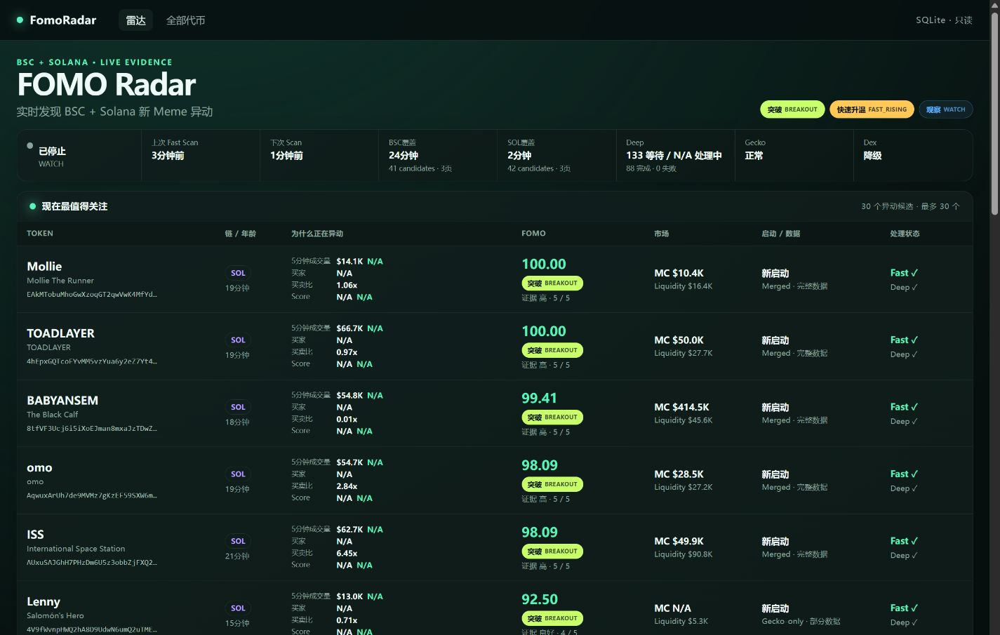

# FomoRadar

FomoRadar 是一个基于 Go 和 SQLite 的本地多市场机会扫描系统。项目目前覆盖 BSC / Solana 新币、主流加密资产和美股永续合约，提供候选发现、可解释评分、风险过滤、交易计划、Web 看板、历史统计和 Signal Lab 效果验证。

源码仓库：[AlenmaskJ/fomo-radar](https://github.com/AlenmaskJ/fomo-radar)。以下说明以当前仓库实现为准。

> 本项目仅用于技术研究与演示，不构成投资建议，不连接交易账户，也不会自动下单。



## 当前能力

| 模块 | 当前实现 |
| --- | --- |
| 新币 / 异动雷达 | 合并 GeckoTerminal 新池、热门 / 高成交量池、DexScreener 候选和本地观察池，执行 Fast / Deep 两阶段扫描 |
| 主流币雷达 | 使用 OKX 公共行情和多周期 K 线构建动态候选池，结合价格、成交量、持仓量、资金费率和 BTC 基准评分 |
| 美股雷达 | 从静态审阅白名单和 OKX 股票永续合约中筛选候选，使用 SPY 作为市场基准 |
| 交易计划 | 根据支撑阻力、ATR 和 tick size 生成分批入场、止损与目标位 |
| Web 看板 | 展示新币、主流币、美股、代币详情和扫描状态；历史榜支持 24 小时 / 7 天、上榜率和收益统计 |
| Signal Lab | 独立进程跟踪新币评分信号后的未来收益、MFE 和 MAE，生成阈值与版本对比报告 |
| Champion / Challenger | 保存不可变历史评分，支持 Challenger 注册、对比、停用和人工审计晋升 |

核心实现特性：

- 新币 Fast 结果先发布，Deep 数据由 4 个 worker、容量为 64 的有界队列异步补充。
- 新池候选默认按 6 小时年龄窗口过滤；Momentum 异动候选使用独立准入规则，不受该窗口限制。
- Deep 结果写入前校验基础 Fast 快照，过期任务标记为 `stale`，不能覆盖新证据。
- 评分同时保留原始分数、证据可信度和最终等级；证据不足时限制展示等级。
- 市场扫描区分 `completed`、`degraded` 和 `failed`；失败运行不会覆盖上一份完整结果。
- 主流币与美股共用分析代码，但候选池、K 线缓存、扫描状态和结果相互隔离。
- SQLite 启用 WAL、外键和 `busy_timeout`；Web 模板和静态资源直接嵌入 Go 二进制。

## 架构

```text
GeckoTerminal / DexScreener               OKX 公共行情 / K 线
             │                                      │
             ▼                                      ▼
       候选发现与补全                      动态币池 / 美股池
             │                                      │
       Fast Scan ──► Deep Queue              多周期指标与交易计划
             │                                      │
             └──────────────────┬───────────────────┘
                                ▼
                              SQLite
                         ┌──────┴──────┐
                         ▼             ▼
                    Web 看板       Signal Lab
                                       │
                                       ▼
                            Champion / Challenger
```

## 技术栈

- Go 1.26+
- SQLite（`modernc.org/sqlite`，纯 Go 驱动）
- Go `net/http`、`html/template`、goroutine、channel
- GeckoTerminal、DexScreener、OKX 公共 API
- 原生 HTML、CSS 和 JavaScript，无 Node.js 构建链

## 快速开始

需要安装 Go 1.26 或更高版本，并确保运行环境可以访问 GeckoTerminal、DexScreener 和 OKX 公共 API。首次构建需要下载 Go 依赖。项目不附带本地数据库和编译后的可执行文件；数据库由程序初始化。

### 1. 获取源码

```bash
git clone https://github.com/AlenmaskJ/fomo-radar.git
cd fomo-radar
```

### 2. 验证项目

```bash
go test -count=1 ./...
go vet ./...
```

### 3. 构建

Windows PowerShell：

```powershell
# 本地看板与三个雷达只需这两个程序
go build -trimpath -o fomo-scanner.exe ./cmd/fomo
go build -trimpath -o fomo-server.exe ./cmd/fomo-server

# 按需构建命令行市场扫描、Signal Lab 和评分管理工具
go build -trimpath -o fomo-market.exe ./cmd/fomo-market
go build -trimpath -o fomo-lab.exe ./cmd/fomo-lab
go build -trimpath -o fomo-score.exe ./cmd/fomo-score
```

Linux / macOS：

```bash
# 本地看板与三个雷达只需这两个程序
go build -trimpath -o fomo-scanner ./cmd/fomo
go build -trimpath -o fomo-server ./cmd/fomo-server

# 按需构建辅助工具
go build -trimpath -o fomo-market ./cmd/fomo-market
go build -trimpath -o fomo-lab ./cmd/fomo-lab
go build -trimpath -o fomo-score ./cmd/fomo-score
```

### 4. 启动完整本地看板

在项目根目录的两个 PowerShell 终端中分别运行：

```powershell
# 终端一：Web 看板、主流币雷达和美股雷达
.\fomo-server.exe -serve -market-watch -db .\fomo.db -listen 127.0.0.1:18080
```

```powershell
# 终端二：新币持续扫描
$env:FOMO_DB = ".\fomo.db"
.\fomo-scanner.exe -watch
```

上述命令会继承当前终端的代理环境变量。需要直连时，先在两个终端中分别执行：

```powershell
Remove-Item Env:FOMO_PROXY, Env:HTTP_PROXY, Env:HTTPS_PROXY -ErrorAction SilentlyContinue
```

Windows 使用本地 HTTP/HTTPS 代理时，可在完成构建后双击 `start-demo.cmd`，或在 PowerShell 中运行：

```powershell
# 先启动代理软件并连接节点；端口应返回 True
Test-NetConnection 127.0.0.1 -Port 10808 -InformationLevel Quiet
$env:FOMO_PROXY = "http://127.0.0.1:10808"
.\start-demo.cmd
```

`start-demo.cmd` 默认使用 `http://127.0.0.1:10808`，为两个程序统一设置数据库和代理，复用符合脚本检查条件的已有进程，并在主流币扫描成功且健康检查通过后打开 `/market`。首次扫描耗时取决于候选池和网络；脚本提示等待上限为 240 秒，检测到 `failed` 会提前退出。美股扫描独立进行，不阻塞打开页面。

代理地址必须包含 `http://` 或 `https://`，并指向支持该协议的端口。清空 `FOMO_PROXY` 后，一键脚本仍会恢复默认代理；没有代理服务时请使用上面的手动方式。更换代理后，已有进程仍使用启动时的配置，需要停止对应进程再启动。

### 5. 打开页面

| 页面 | 地址 |
| --- | --- |
| 新币雷达 | <http://127.0.0.1:18080/> |
| 主流币雷达 | <http://127.0.0.1:18080/market> |
| 主流币历史榜 | <http://127.0.0.1:18080/market/history> |
| 美股雷达 | <http://127.0.0.1:18080/stocks> |
| 美股历史榜 | <http://127.0.0.1:18080/stocks/history> |

只查看已有数据库、不启动内置市场扫描时，可以省略 `-market-watch`：

```powershell
.\fomo-server.exe -serve -db .\fomo.db -listen 127.0.0.1:18080
```

## 扫描节奏与结果状态

主流币和美股使用各自的调度器，按到期条件更新；调度器每分钟检查一次，扫描耗时和网络延迟会影响实际执行时间。

| 任务 | 当前节奏 |
| --- | --- |
| 新币 Fast 发现 | 启动后立即执行，目标为每 2 分钟开始一轮；耗时超过间隔时不重叠运行 |
| 新币 Deep 补全 | 后台队列持续处理，不等待下一轮 Fast |
| 市场价格、成交额、持仓量和资金费率 | 约每 2 分钟刷新 |
| 市场多周期 K 线 | `15m` 每 5 分钟、`1H` 每 15 分钟、`4H` 每小时、`1Dutc` 每 4 小时 |
| 动态候选池 | 约每 30 分钟重建，每类最多 60 个标的 |
| 启动 / 手动完整扫描 | 重建候选池并刷新全部四个周期；手动扫描完成后冷却 60 秒 |

新币 GeckoTerminal 请求共用约 6 秒一次的限速器，Deep 积压和实际覆盖范围可在扫描输出中查看。候选年龄窗口不代表每轮 API 都能覆盖完整的 6 小时。

市场扫描的 `completed` 表示完整成功，`degraded` 表示保留可用结果并记录部分失败，`failed` 表示本轮失败且不覆盖上一份完整报告。零候选也可以是正常结果；最近完整结果超过 10 分钟时，页面提示过期，健康检查返回 503。

## 可执行程序

| 程序 | 用途 | 主要模式 |
| --- | --- | --- |
| `fomo-scanner` | BSC / Solana 新币扫描 | `-scan`、`-watch` |
| `fomo-server` | Web 看板及内置市场调度器 | `-serve`、可选 `-market-watch` |
| `fomo-market` | 命令行主流币机会扫描 | `-scan`、`-watch` |
| `fomo-lab` | 信号归档、成熟结果计算和报告 | `-run-once`、`-watch`、`-report` |
| `fomo-score` | 评分版本和角色管理 | `list`、`add`、`compare`、`promote`、`disable` |

常用命令：

```bash
# 新币完整扫描
./fomo-scanner -scan

# 主流币单次扫描
./fomo-market -scan -db ./fomo.db

# 更新并查看 Signal Lab
./fomo-lab -run-once -source-db ./fomo.db -lab-db ./fomo-lab.db
./fomo-lab -report -lab-db ./fomo-lab.db

# 查看 Champion / Challenger
./fomo-score list --db ./fomo.db
./fomo-score compare --db ./fomo.db --lab-db ./fomo-lab.db
```

完整的 Challenger 注册、晋升和回滚流程见[核心扫描器运维说明](docs/operations/core-scanner.md)。

### 持续运行 Signal Lab

一键脚本不启动 Signal Lab。需要积累评分效果数据时，在新币扫描器运行后另开终端：

```powershell
.\fomo-lab.exe -watch -source-db .\fomo.db -lab-db .\fomo-lab.db -interval 2m
```

查看表格或 JSON 报告：

```powershell
.\fomo-lab.exe -report -lab-db .\fomo-lab.db
.\fomo-lab.exe -report -lab-db .\fomo-lab.db -format json
```

Lab 只读 Core 数据库，统计写入独立的 `fomo-lab.db`。首次初始化记录当前快照位置，从此后的新信号开始跟踪，不回填初始化之前的信号；未来观察数据尚未成熟时不能立即得到收益结论。版本对比中的缺失统计显示 `N/A`，样本不足显示 `INSUFFICIENT`，晋升仍需人工决定。

## 配置

| 环境变量 | 默认值 | 用途 |
| --- | --- | --- |
| `FOMO_DB` | `./fomo.db` | Core SQLite 数据库路径 |
| `FOMO_LAB_DB` | `./fomo-lab.db` | Signal Lab 数据库路径 |
| `FOMO_HTTP_ADDR` | `127.0.0.1:8080` | Web 服务监听地址 |
| `FOMO_PROXY` | 空 | `fomo-server`、`fomo-market` 的显式 HTTP/HTTPS 代理；一键脚本默认设为 `http://127.0.0.1:10808` |
| `HTTP_PROXY` / `HTTPS_PROXY` | 继承系统环境 | 所有 Provider 的标准 Go HTTP 代理；市场程序设置显式代理时优先使用显式值 |
| `FOMO_DEEP_SCAN_THRESHOLD` | `40` | 进入 Deep 扫描的最低分数，范围 `0..100` |

命令行参数优先于对应环境变量。Web 演示命令使用 `127.0.0.1:18080`，与程序自身的默认监听端口 `8080` 不同。

## Web 路由与请求边界

| 路由 | 方法 | 用途 |
| --- | --- | --- |
| `/`、`/token/{address}`、`/api/tokens` | `GET` | 新币列表、详情和 JSON 数据 |
| `/market`、`/market/history` | `GET` | 主流币当前机会与历史榜单 |
| `/stocks`、`/stocks/history` | `GET` | 美股当前机会与历史榜单 |
| `/api/market/status`、`/api/stocks/status` | `GET` | 市场扫描状态 |
| `/api/market/scan`、`/api/stocks/scan` | `POST` | 手动触发扫描，带 60 秒冷却 |
| `/health/market`、`/health/stocks` | `GET` | 最近完整结果健康检查 |

项目没有用户登录、Session、JWT 或 Bearer Token。默认监听回环地址；手动扫描接口要求 `application/json`，并校验同源 `Origin` 或回环来源。这是本地访问边界，不是公网认证方案。

## 常见问题

### 一键启动提示 `Startup scan failed`

这表示当前市场扫描失败，后台程序可能仍在运行。先检查代理软件是否已连接节点，以及代理端口和 OKX 请求是否可用：

```powershell
Test-NetConnection 127.0.0.1 -Port 10808 -InformationLevel Quiet
curl.exe --proxy http://127.0.0.1:10808 --max-time 20 "https://www.okx.com/api/v5/public/instruments?instType=SWAP"
```

端口可连接只说明本地代理已监听，不能保证上游可达。`proxyconnect ... refused` 通常表示代理未启动或端口错误；`context deadline exceeded` 需要继续检查节点和网络。

查看当前扫描状态、进度和错误摘要：

```powershell
Invoke-RestMethod http://127.0.0.1:18080/api/market/status | Format-List
Invoke-WebRequest -UseBasicParsing http://127.0.0.1:18080/health/market
```

修复网络后，可在网页点击“立即扫描”，或从本机 PowerShell 触发：

```powershell
Invoke-RestMethod -Method Post -Uri http://127.0.0.1:18080/api/market/scan -ContentType "application/json" -Body '{}'
```

确认完整扫描结果恢复且 `/health/market` 返回 200 后，再运行 `start-demo.cmd`。`trigger=snapshot` 的任务只刷新行情，其 `completed` 状态不能替代完整结果的健康检查。

一键启动的后台窗口隐藏；需要看服务日志时，先停止该项目已有的 `fomo-server.exe`，再在终端使用快速开始中的服务命令运行，按实际环境补充 `-proxy`。

### 页面没有机会或提示数据未就绪

首次完整扫描结束前，健康检查返回 503；首次运行还缺少历史 OI 基线。扫描完成后如果没有标的达到门槛，空榜单属于正常结果。历史榜和 Signal Lab 都依赖持续运行积累的本地数据，刚克隆仓库时不会附带历史记录。

### 提示缺少程序或端口已占用

`Missing fomo-server.exe` / `Missing fomo-scanner.exe`：先构建两个必要程序。`bind ... address already in use`：检查 18080 是否被其他进程占用；手动启动可更改 `-listen`，并同步修改访问地址。一键脚本固定使用 18080。

## 数据与安全边界

- 只调用公开市场接口，不需要交易所 API Key。
- 不读取账户、余额、仓位或订单，不调用下单接口。
- 本地数据库、运行报告、`.env` 和编译产物已通过 `.gitignore` 排除。
- 若改为 `0.0.0.0` 或通过反向代理公开服务，应在外层增加身份认证、TLS 和访问控制。
- 免费数据源可能存在延迟、限流、缺失或短时不可用；程序会保留降级状态和错误摘要。
- 美股雷达读取的是股票永续合约，不等同于美国现货市场；休市期间可能出现额外流动性和价格偏差。

## 项目结构

```text
cmd/                    五个可执行程序入口
internal/providers/     GeckoTerminal、DexScreener、OKX 数据适配
internal/scanner/       新币发现、Fast / Deep 扫描与过滤
internal/score/         可解释评分和版本集合
internal/markets/       多周期指标、机会评分与交易计划
internal/marketwatch/   主流币 / 美股动态候选池与调度
internal/store/         Core SQLite 存储和迁移
internal/lab/           独立 Signal Lab 数据库与效果分析
internal/web/           Web 路由、模板、静态资源和只读查询
tests/fixtures/         Provider 与评分测试数据
docs/                   运维说明、设计记录和界面截图
```

## 更多文档

- [动态机会雷达使用说明](docs/operations/dynamic-market-radar.md)
- [核心扫描器运维说明](docs/operations/core-scanner.md)
- [Dashboard Phase 1 设计](docs/plan2-dashboard-design.md)
- [Signal Lab 实施报告](docs/plan3-signal-lab-implementation-report.md)
